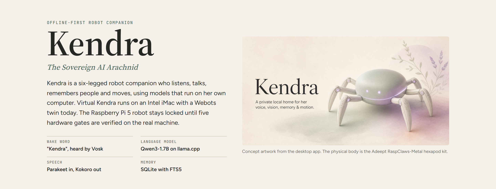
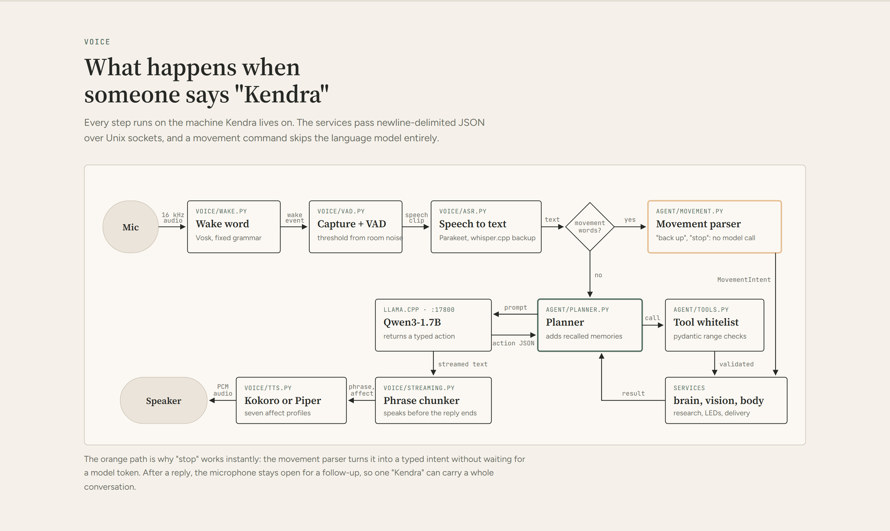
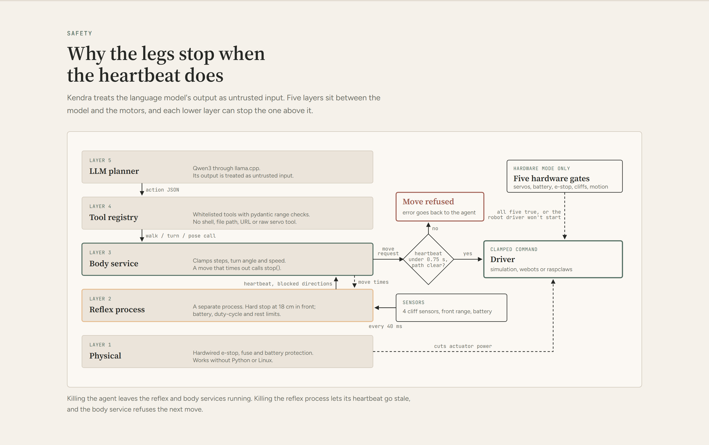
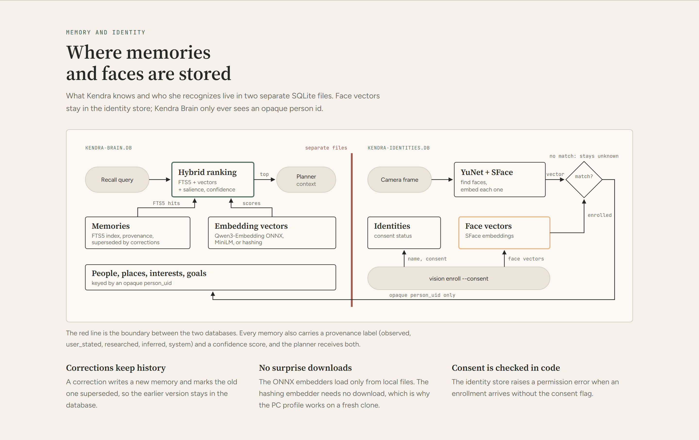
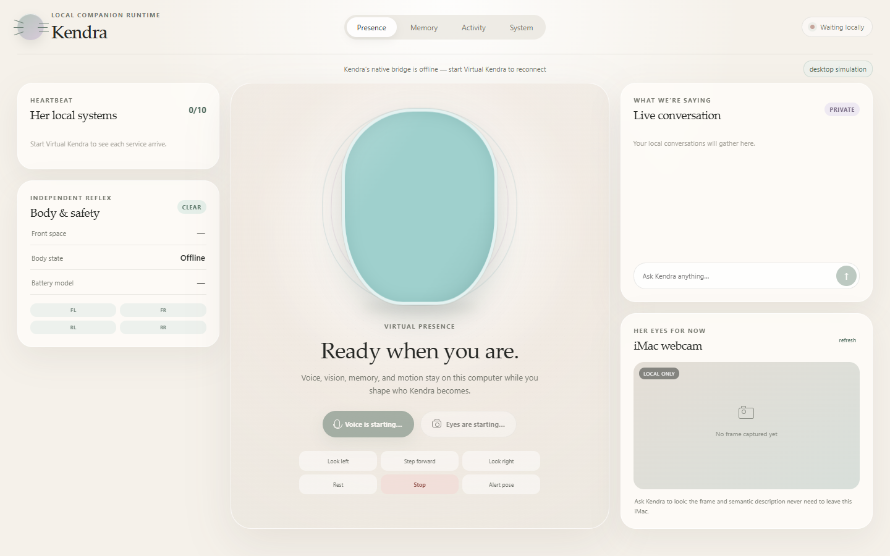
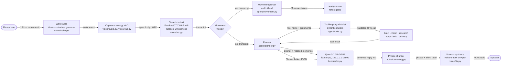
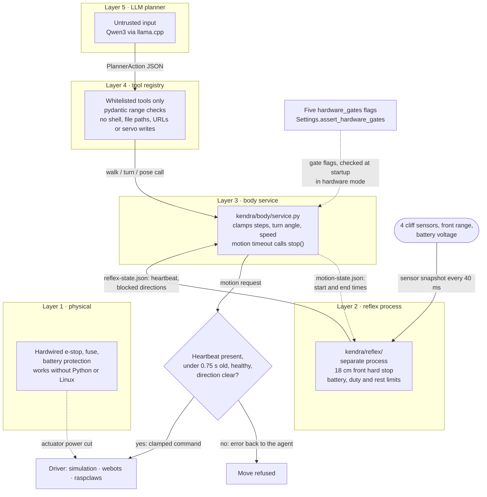
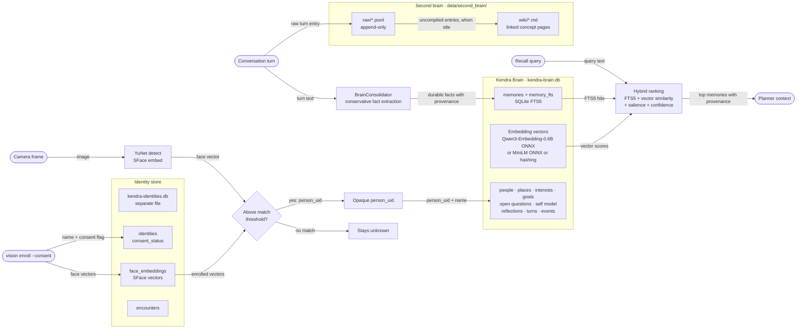

<div align="center">

<a href="https://nxtlupo.github.io/kendra/"></a>

**Kendra is an offline-first AI companion for a six-legged robot. Her voice, vision, memory and motion all run on local models, and she uses no hosted AI service.**


**[Open the illustrated overview](https://nxtlupo.github.io/kendra/)**

</div>

---

## How Kendra works, at a glance

<picture>
  <source media="(prefers-color-scheme: dark)" srcset="docs/readme/overview-voice-dark.png">
  
</picture>

<picture>
  <source media="(prefers-color-scheme: dark)" srcset="docs/readme/overview-safety-dark.png">
  
</picture>

<picture>
  <source media="(prefers-color-scheme: dark)" srcset="docs/readme/overview-memory-dark.png">
  
</picture>

The sections below give the full detail behind each picture.

## What Kendra is and where it runs

| | |
|---|---|
| **The software** | A Python runtime made of eleven small services (voice, agent, brain, identity, vision, body, reflex, research, LEDs, delivery, autonomy) and an Electron desktop app |
| **The machines** | Virtual Kendra runs on an Intel iMac (`x86_64` macOS) with a Webots digital twin. The robot computer is a Raspberry Pi 5 |
| **Talking to her** | You say "Kendra". Speech recognition, reasoning and speech synthesis run on the same computer |
| **Her memory** | Kendra Brain, one SQLite database with FTS5 full-text search and local embedding vectors |
| **Her body** | One body API (`walk`, `turn`, `pose`, `look`, `stop`) drives both the simulator and the robot, and an independent reflex process can veto any move |
| **Internet use** | Inference never touches the network. Live web research and photo delivery are the only features that need a connection |

## What the desktop app shows

<p align="center">
  
</p>

<sub>The dashboard renderer, built from <code>dashboard/</code> and opened in a browser with no Kendra services running. Every card is in its offline state (0/10 services, "native bridge is offline"). The animated 3D body model is gitignored (<code>dashboard/public/kendra3d/</code>), so the stage shows its placeholder shape.</sub>

The desktop app has four tabs. Presence shows the service heartbeat, the reflex lock and the four cliff sensors, the live conversation, the latest webcam frame and a small motion pad. Memory searches Kendra Brain, imports a JSONL export from the robot, pulls memories over SSH with strict host-key checking, and makes backups. Activity lists recent turns and cognitive events, and System shows the signed upgrade channel and which local models are up.

The app is a native Electron window with no HTTP server behind it. Its sandboxed renderer (`contextIsolation`, `sandbox`, no Node integration) can call only an allowlist of named commands over Electron IPC. Electron's main process hands each command to a Python `dashboard-bridge` child process over stdin and stdout; [`docs/DASHBOARD.md`](docs/DASHBOARD.md) has the setup.

## What each part of the code does

| Capability | What it does | Module |
|---|---|---|
| Wake word | Vosk listens for "Kendra" (also "hi Kendra" and "hey Kendra") with a constrained grammar. "Stop Kendra" is a secondary spoken interrupt | `kendra/voice/wake.py` |
| Audio capture and VAD | The capture code probes every input device and picks the one carrying a live signal. The energy VAD sets its threshold from the room's measured noise floor | `kendra/voice/audio.py`, `kendra/voice/vad.py` |
| Speech recognition | Parakeet TDT 0.6B v3 int8 runs in process through `onnx-asr`. When it fails, the ASR module falls back to a whisper.cpp server and then `whisper-cli`. Moonshine ONNX is the lower-RAM option | `kendra/voice/asr.py` |
| Reasoning | llama.cpp `llama-server` hosts Qwen3-1.7B GGUF on `127.0.0.1:17800` with two slots, so background memory work keeps the conversation's cached prompt | `kendra/llm.py`, `scripts/start_llm_intel_macos.sh` |
| Planner and typed tools | The planner asks the model for a JSON-schema-constrained `PlannerAction`. `ToolRegistry` accepts only whitelisted tools with pydantic-bounded arguments, and it has no shell, file-path or raw servo tool | `kendra/agent/planner.py`, `kendra/agent/tools.py` |
| Streaming speech with affect | llama.cpp streams each reply into phrase-sized chunks, so Kendra starts speaking before generation ends. Seven affect profiles (neutral, warm, curious, concern, alert, delighted, reflective) set the prosody | `kendra/voice/streaming.py`, `kendra/voice/tts.py` |
| Deterministic movement | The movement parser turns "come here", "back up", "turn left", "go forward three feet" and "stop" into a typed `MovementIntent` without calling the LLM. Kendra says what she is about to do before she moves | `kendra/agent/movement.py` |
| Kendra Brain | One SQLite database with FTS5 and local embeddings. Each memory has provenance, a correction marks the old record superseded, `BrainConsolidator` extracts durable facts in the background, and the CLI makes SQLite backups and JSONL exports | `kendra/brain/` |
| Second brain wiki | The brain service appends turns, sights and research results to an append-only JSONL log. An idle LLM pass compiles that log into linked markdown pages under `data/second_brain/` | `kendra/brain/second_brain.py` |
| Vision | OpenCV captures webcam or Pi camera frames. YuNet finds faces, SFace embeds them, ArUco finds the home marker, and Moondream2 on `127.0.0.1:17801` describes the scene | `kendra/vision/` |
| Person recognition | `IdentityStore` enrolls a person only when the consent flag is set and keeps face vectors in a separate database. A face below the match threshold stays unknown | `kendra/identity/` |
| Reflex safety | A separate process reads the cliff sensors, front range, battery voltage and motion duty, then writes the heartbeat that the body service checks before every move | `kendra/reflex/` |
| Body drivers | The `simulation`, `webots` and `raspclaws` drivers share one API. `BodyService` clamps steps, turn angle and speed, and calls `stop()` when a move times out | `kendra/body/` |
| Research | SearXNG finds pages, `SafeFetcher` blocks private and loopback addresses, and `trafilatura` extracts the text. Kiwix answers offline, and `sky.py` computes the moon phase from the clock | `kendra/research/` |
| Expression and lights | Performances combine voice, body motion and LEDs. The LEDs breathe cyan while Kendra composes a reply, chase blue while she researches and tick green while she looks | `kendra/expression/`, `kendra/leds/` |
| Signed upgrades | A spoken upgrade request installs only a minisign-signed release with a matching SHA-256, into the inactive A/B slot, after the owner says the exact confirmation phrase | `kendra/updates/` |
| Health checks | `kendra doctor` checks prerequisites. The spoken diagnostic gives each check one plain sentence for the owner and the technical detail for the app | `kendra/health/` |
| Dev stack | `kendra dev start`, `stop` and `status` launch and track every service on one machine | `kendra/devstack.py` |
| Desktop app | An Electron, React and three.js window that reaches Python only through the stdio bridge | `dashboard/`, `kendra/dashboard/` |

## How the AI pieces fit together

### What happens when someone says "Kendra"

Every step below runs on the computer Kendra lives on. The services pass messages to each other as newline-delimited JSON RPC over Unix domain sockets (`kendra/ipc.py`).



The voice service shortens the wait in two ways. It lets the first phrase of a reply be as short as 14 characters (`voice.streaming.first_phrase_chars`), so Kendra starts talking sooner, and it plays quiet synthesized blips while she transcribes or generates. When a reply ends, the voice service keeps the microphone open for a follow-up, which means a single "Kendra" can carry a whole conversation.

### Why the legs stop when the heartbeat does

Kendra treats the LLM's output as untrusted input. Five layers sit between the model and the motors, and each lower layer can stop the one above it ([`docs/ARCHITECTURE.md`](docs/ARCHITECTURE.md)).



- Killing the agent leaves the reflex and body services running. Killing the reflex process lets its heartbeat go stale, and `BodyService` refuses the next move.
- Spoken movement commands go straight from the movement parser to the body service, so "stop" reaches the legs without waiting for a model token.
- With `project.mode: hardware`, `BodyService` refuses to start until all five gates are `true`: servo mapping, battery path, e-stop, cliff array and motion calibration.

### Where memories and faces are stored

Kendra keeps what she knows and who she recognizes in two separate SQLite files. Face vectors stay in the identity store and never enter Kendra Brain.



- Every memory carries a provenance label (`observed`, `user_stated`, `researched`, `inferred`, `system`) and a confidence score, and the planner receives both with each recalled memory.
- A correction writes a new memory and sets `superseded_by` on the old one, so the earlier version stays in the database.
- The hashing embedder needs no download, which is why `config/pc.yaml` works on a fresh clone. The ONNX embedders load only from local files and refuse to download at runtime.
- `IdentityStore` raises `PermissionError` when an enrollment arrives without consent.

### Which models run where

| Role | Default model or engine | Runs as | Defined in |
|---|---|---|---|
| Language | Qwen3-1.7B GGUF, Q4_K_M generated locally from the SHA-pinned Q8_0 | llama.cpp `llama-server` on `127.0.0.1:17800` | `scripts/start_llm_intel_macos.sh` |
| Scene vision | Moondream2 (Q4_K_M text model + f16 projector) | llama.cpp on `127.0.0.1:17801` | `scripts/start_vlm_intel_macos.sh` |
| Faces | YuNet (detection) + SFace (embedding) | OpenCV, in process | `kendra/vision/service.py` |
| Speech recognition | Parakeet TDT 0.6B v3 int8 when its files are present, otherwise whisper.cpp `small.en`. Moonshine ONNX is optional | onnxruntime or whisper.cpp | `kendra/voice/asr.py` |
| Wake word | Vosk small en-US, constrained grammar | in process | `kendra/voice/wake.py` |
| Speech synthesis | Kokoro-82M ONNX (voice `af_heart`). Piper `en_US-amy-medium` is the rollback | onnxruntime or Piper | `kendra/voice/tts.py` |
| Memory embeddings | Qwen3-Embedding-0.6B int8 ONNX. MiniLM ONNX and hashing are the alternatives | onnxruntime, in process | `kendra/brain/embeddings.py` |
| Digital twin | Webots world `kendra_virtual.wbt` | JSON-lines bridge on `127.0.0.1:8765` | `simulator/webots/` |
| Optional research | SearXNG / Kiwix | `127.0.0.1:8888` / `127.0.0.1:17890` | `config/default.yaml` |

## Running it

### Run the tests and Kendra Brain on any computer

This path needs Python 3.11 or newer and nothing else. While this README was prepared, the steps ran on Windows 11 with Python 3.11: `pytest -q` reported 81 passed, and the brain commands stored and then found a memory.

```bash
git clone https://github.com/NXTLupo/kendra.git
cd kendra
python -m venv .venv
source .venv/bin/activate            # Windows: .venv\Scripts\activate
pip install -e ".[dev]"
pytest -q

# Kendra Brain with the zero-download hashing embedder (config/pc.yaml)
python -m kendra --config config/pc.yaml init
python -m kendra --config config/pc.yaml brain remember "Kendra runs her language model on llama.cpp." --provenance user_stated
python -m kendra --config config/pc.yaml brain search "language model"

# Print the hardware gates of the robot profile (all false)
python -m kendra --config config/production.example.yaml gates
```

These commands use `config/pc.yaml` because it selects the hashing embedder. `config/default.yaml` and `config/webots.yaml` select the Qwen3 embedding model, so `init` with either profile stops and prints "Run scripts/fetch_local_models.py --embeddings" until that model is on disk.

### Run the full Virtual Kendra stack on an Intel iMac

Voice, webcam, Webots and the local models need a real desktop. The scripts expect an Intel iMac (`uname -m` prints `x86_64`) with Homebrew under `/usr/local`, and [`docs/INTEL_IMAC_VIRTUAL_KENDRA.md`](docs/INTEL_IMAC_VIRTUAL_KENDRA.md) is the full guide.

**1. Bootstrap.** The script installs Homebrew packages, creates `.venv`, builds a pinned llama.cpp commit and whisper.cpp v1.9.1, downloads the public model files, initializes Kendra Brain and runs the tests.

```bash
./scripts/bootstrap_intel_macos.sh
```

**2. Fetch the default memory and voice models.** The bootstrap downloads the Qwen3 LLM, Moondream2, whisper.cpp, Piper, Vosk, face and MiniLM models (`--core --vlm`). `config/default.yaml` also names the Qwen3 embedding model and the Kokoro voice, which need:

```bash
.venv/bin/python scripts/fetch_local_models.py --embeddings --kokoro
.venv/bin/python -m pip install kokoro-onnx
```

**3. Open the digital twin.** Load `simulator/webots/worlds/kendra_virtual.wbt` in Webots.

**4. Start the local models**, each in its own Terminal:

```bash
./scripts/start_llm_intel_macos.sh     # Qwen3-1.7B on 127.0.0.1:17800
./scripts/start_vlm_intel_macos.sh     # Moondream2 on 127.0.0.1:17801 (optional)
```

**5. Start Kendra's services:**

```bash
source .venv/bin/activate
python -m kendra --config config/webots.yaml init
python -m kendra --config config/webots.yaml doctor
python -m kendra --config config/webots.yaml dev start --voice
```

**6. Open the desktop app** in another Terminal, then say "Kendra":

```bash
./scripts/start_kendra_dashboard_intel_macos.sh config/webots.yaml
```

`python -m kendra --config config/webots.yaml dev status` lists the running services, `python -m kendra --config config/webots.yaml chat` opens text chat in the terminal, and `./scripts/stop_virtual_kendra.sh` stops everything.

macOS asks for microphone and camera permission the first time each device opens. For the robot itself, [`docs/INSTALL_PI.md`](docs/INSTALL_PI.md) and [`docs/TRANSPLANT_GUIDE.md`](docs/TRANSPLANT_GUIDE.md) cover the Raspberry Pi install.

## How configuration is layered

`kendra/config.py` loads `config/default.yaml` on every run, then deep-merges one overlay named by `--config` or `KENDRA_CONFIG`. When no overlay is named, it merges `config/local.yaml` and `config/hardware.local.yaml` if they exist. Git ignores both of those files.

| File | Purpose | Key settings |
|---|---|---|
| `config/default.yaml` | Base for every profile | `project.mode: simulation`, all five `hardware_gates: false`, llama.cpp endpoint, voice providers, brain retrieval budgets, reflex thresholds, research endpoints, update channel |
| `config/pc.yaml` | Desktop simulation without Webots | 18-joint digital-twin capabilities, hashing embeddings, Moondream ONNX for vision questions, spoken-stop monitor off |
| `config/webots.yaml` | Desktop with the 3D Webots body | `body.driver: webots` on `127.0.0.1:8765`, reflex sensors read from Webots |
| `config/production.example.yaml` | Template for the Pi robot | `project.mode: hardware`, `/var/lib/kendra` data paths, `raspclaws` driver, `picamera2`, whisper.cpp ASR, MCP23017 cliff-sensor bridge, every gate `false` |
| `config/hardware.example.yaml` | Safe local starting point | `kendra init` copies it to the ignored `config/hardware.local.yaml`: simulation mode, gates `false` |
| `config/kendra.env.example` | Environment for the systemd units | `KENDRA_ROOT`, `KENDRA_CONFIG`, `KENDRA_LLM_MODEL` |
| `config/recipients.example.json` | Photo-delivery alias template (Signal, SMTP) | Real recipients go in the ignored `config/recipients.local.json`, and the model only ever sees aliases |
| `config/minisign.pub` | Public key for signed releases | A placeholder until the owner creates the release key outside Git |

## Why everything runs on the machine itself

- **Privacy.** Kendra calls no hosted LLM, speech, vision, embedding, face-recognition or wake-word API, and she needs no API key. Audio, camera frames and memories stay on the computer. Face vectors sit in their own database, and no recognition service ever receives them.
- **Offline operation.** Once the model files are on disk, the wake word, speech recognition, conversation, memory, sight, face recognition and the simulator all keep working with the network unplugged. Live web research and photo delivery are the two features that need a connection.
- **No usage fees.** All inference is local, so there are no per-token or per-minute speech charges.
- **Motor safety.** The LLM can only propose typed tools. The reflex process, the body service's heartbeat check, and the hardwired e-stop and fuse each sit between the model and the motors.
- **Fail-closed hardware.** Real motion stays off until servo mapping, battery path, e-stop, cliff sensors and motion calibration are verified on the exact robot. The servo channel map comes from the physical kit; the simulator's joint layout is never copied into it.
- **Inspectable memory.** Kendra Brain is one SQLite file. Every record has provenance, a correction keeps the old version, and the CLI can make an online backup or a JSONL export.
- **Owner-controlled upgrades.** Development happens in Git on the desktop. The robot installs only signed releases from fixed paths, and only after the owner says the exact confirmation phrase.

## What works today and what is still locked

Virtual Kendra on the desktop is the current milestone. The physical body comes later and stays locked until the gates below pass.

| Area | State | Evidence |
|---|---|---|
| Python services and unit tests | Implemented, passing | `pytest -q` reported 81 passed on Windows 11 / Python 3.11. CI runs Ruff, pytest and compile checks on Python 3.11 and 3.12 |
| Voice loop, brain, identity, vision, Webots bridge | Implemented | [`BUILD_STATE.md`](BUILD_STATE.md) |
| Desktop rehearsal on the Intel iMac | Feature-complete for rehearsal; formal qualification not recorded as passed | `BUILD_STATE.md` (2026-08-18 entry). The ten-point acceptance list is in [`docs/INTEL_IMAC_VIRTUAL_KENDRA.md`](docs/INTEL_IMAC_VIRTUAL_KENDRA.md) |
| Desktop app tests | One known failure | `dashboard/tests/rendered-html.test.mjs` still expects the retired PNG portrait in `app/page.tsx`, so `npm test` passes 1 of 2 checks. The build and lint pass |

| Physical gate | State |
|---|---|
| Adeept Metal resource archive identified | PASS |
| 17-servo / controller-channel mapping verified on this exact kit | NOT VERIFIED |
| Battery protection, balancing and charge path verified | NOT VERIFIED |
| Physical e-stop and fuse installed and continuity-tested | NOT VERIFIED |
| Four cliff sensors installed and calibrated | NOT VERIFIED |
| Motion calibration completed | NOT VERIFIED |
| Power torture test completed | NOT VERIFIED |
| Baseline physical acceptance suite | NOT RUN |

`python -m kendra --config config/production.example.yaml gates` prints the gate flags, and while any of them is false, `BodyService` keeps real motion disabled. [`docs/HARDWARE_GATES.md`](docs/HARDWARE_GATES.md) describes how to verify each gate, and [`docs/SHOPPING_LIST.md`](docs/SHOPPING_LIST.md) lists the parts.

## Start here

Coding agents taking over this project should read [`START_HERE_CODING_AGENT.md`](START_HERE_CODING_AGENT.md) first.

People building by hand can follow this order:

1. [`docs/INTEL_IMAC_VIRTUAL_KENDRA.md`](docs/INTEL_IMAC_VIRTUAL_KENDRA.md)
2. [`docs/ARCHITECTURE.md`](docs/ARCHITECTURE.md), then the current snapshot in [`docs/ARCHITECTURE_CURRENT.md`](docs/ARCHITECTURE_CURRENT.md)
3. [`docs/KENDRA_BRAIN.md`](docs/KENDRA_BRAIN.md)
4. [`docs/HARDWARE_GATES.md`](docs/HARDWARE_GATES.md)
5. [`docs/KENDRA_BUILD_GUIDE_V3.md`](docs/KENDRA_BUILD_GUIDE_V3.md)

## Rules every change must keep

- Local AI inference only. No hosted LLM, speech, vision or embedding API is required.
- The wake phrase is **`Kendra`**.
- Voice path: local wake detection, local audio capture and VAD, local ASR (Parakeet or whisper.cpp, with Moonshine as an option), local llama.cpp, streamed local TTS (Kokoro or Piper).
- Affect labels control local TTS prosody. They are not claims that a model literally experiences emotions.
- Kendra Brain is native SQLite/FTS5 plus local embeddings. It does not require a note-taking application.
- Person recognition is local and consent-checked. Biometric embeddings live in a separate identity database.
- The LLM can only propose typed, whitelisted tools.
- Reflex safety runs independently of the LLM and the agent.
- A stale or missing reflex heartbeat disables motion.
- Physical mode stays disabled until every hardware gate is verified on the exact robot.

<details>
<summary><b>Repository map</b></summary>

```text
kendra/
├── START_HERE_CODING_AGENT.md   # handoff for coding agents
├── README.md
├── BUILD_STATE.md               # what is implemented and which gates pass
├── pyproject.toml
├── charter/                     # Kendra's charter (persona and policy prompt)
├── config/                      # default.yaml + pc / webots / production overlays
├── dashboard/                   # Electron + React + three.js desktop app
├── docs/                        # architecture, guides, gates, research notes
├── hardware/                    # vendor bridge template (audited vendor code stays out of Git)
├── kendra/                      # the Python runtime
│   ├── agent/                   # planner, typed tools, movement intents
│   ├── autonomy/                # optional autonomous behavior (off by default)
│   ├── body/                    # simulation, Webots and RaspClaws drivers
│   ├── brain/                   # Kendra Brain, consolidation, second brain, sync
│   ├── dashboard/               # stdio bridge for the desktop app
│   ├── delivery/                # alias-based photo delivery
│   ├── expression/              # performances: voice + motion + lights
│   ├── health/                  # doctor and spoken self-check
│   ├── identity/                # consent-checked face identity store
│   ├── leds/                    # light patterns
│   ├── reflex/                  # independent safety process
│   ├── research/                # SearXNG, Kiwix, safe fetcher, sky
│   ├── updates/                 # signed A/B release installer
│   ├── vision/                  # camera, faces, ArUco, VLM
│   └── voice/                   # wake, VAD, ASR, TTS, streaming
├── manifests/                   # model, hardware and software pins
├── notebooks/                   # fine-tuning and steering experiments
├── scripts/                     # bootstrap, model fetch, start/stop, releases
├── searxng/                     # optional local search aggregator
├── simulator/webots/            # digital twin world and bridge controller
├── systemd/                     # one unit per service for the Pi
└── tests/                       # pytest suite (never energizes hardware)
```

`.gitignore` keeps large models, databases, runtime sockets, logs, photos, local secrets and audited vendor hardware code out of the repository.

</details>

<details>
<summary><b>The Virtual Kendra digital twin</b></summary>

The Webots digital twin accepts the same high-level body verbs as the future physical driver:

```text
walk
turn
pose
look
stop
```

The world contains a platform edge, an obstacle, a human-sized target and a home/perch target. Four simulated cliff positions and front-range telemetry feed the same independent reflex layer that the physical robot uses.

Each of the six virtual legs has visible coxa, femur and tibia joints, so gait behavior can be evaluated before hardware exists. The simulation is **not** the authority for the RaspClaws-Metal's final 17-servo channel map, servo centers, torque limits or battery topology; those are physical verification gates. Use `config/webots.yaml` whenever the 3D body should receive walk, turn, look, pose and stop commands.

</details>

<details>
<summary><b>How the voice service behaves</b></summary>

A local Vosk grammar recognizes the wake phrase `Kendra`. The ASR module transcribes the speech on the same machine. The planner makes a short schema-constrained decision first, and then llama.cpp streams the spoken answer into phrase-sized TTS chunks, so Kendra starts speaking before the whole response exists.

Her affect profiles are neutral, warm, curious, concern, alert, delighted and reflective.

`Stop Kendra`, `Kendra stop` and `stop` are secondary spoken stop phrases. On the robot, the physical emergency stop remains the real kill switch.

The desktop app's **Talk with Kendra** button starts a hands-free turn. The voice service opens the microphone and pauses wake listening so two streams never compete for it, and the energy VAD ends the capture when the speaker stops talking. **Use my webcam** captures a frame locally and can ask the loopback VLM for a scene description.

`project.interaction_mode: voice_first` in `config/default.yaml` turns off typed chat in the desktop app. The `kendra chat` command still reaches the agent from a terminal.

</details>

<details>
<summary><b>Kendra Brain commands</b></summary>

The development database is `data/kendra-brain.db`. It stores episodes, facts, preferences, relationships, places, interests, goals, open questions, self-model state, reflections, turns, links and cognitive events, each with provenance and confidence.

```bash
python -m kendra --config config/pc.yaml brain stats
python -m kendra --config config/pc.yaml brain search "query"
python -m kendra --config config/pc.yaml brain correct MEMORY_ID "corrected content" --reason "why it changed"
python -m kendra --config config/pc.yaml brain backup
python -m kendra --config config/pc.yaml brain export-jsonl
```

[`docs/KENDRA_BRAIN.md`](docs/KENDRA_BRAIN.md) and [`docs/SECOND_BRAIN.md`](docs/SECOND_BRAIN.md) go deeper.

</details>

<details>
<summary><b>How people recognition handles consent</b></summary>

Biometric data lives in its own database, `data/kendra-identities.db`.

From the command line, enrollment requires an explicit `--consent` flag, which the operator adds only after the person agrees:

```bash
python -m kendra --config config/webots.yaml vision enroll "Their Name" \
  --relationship owner --frames 10 --consent
python -m kendra --config config/webots.yaml vision recognize
```

A face below the match threshold stays unknown. Kendra never sends identity embeddings to a hosted recognition service.

The ambient meet-new-people behavior (`vision.ambient.meet_new_people`, on in `config/default.yaml`) greets an unfamiliar face, asks for a name and then enrolls that face. Set it to `false` if a spoken introduction should not count as consent to enrollment.

</details>

<details>
<summary><b>Moving memories from the robot to the desktop</b></summary>

The desktop app can search and back up the active local brain, then merge memories from Kendra's physical body without copying any biometric identity data:

- **Cable or removable drive:** export Kendra Brain JSONL on the robot and choose that file in the app.
- **Local Wi-Fi:** pre-authorize an SSH key and host key, then press **Retrieve memories now**. The app connects over SSH with strict host-key checking and runs the robot's fixed `brain export-jsonl --stdout` command.

The importer re-embeds each memory locally, keeps its provenance and original timestamp in metadata, and skips duplicates. [`docs/DASHBOARD.md`](docs/DASHBOARD.md) has the setup.

</details>

<details>
<summary><b>How intelligence upgrades reach the robot</b></summary>

Development stays on the desktop: the owner improves and tests Kendra there, commits, and pushes to the pinned GitHub repository. Kendra has typed voice tools for checking and requesting an upgrade, and the installer fails closed:

- it accepts only the fixed `NXTLupo/kendra` GitHub release paths;
- the minisign signature and the archive SHA-256 must verify;
- it builds the release in the inactive A/B slot;
- it never activates unsigned Git code;
- voice installation stays disabled until the owner creates a private release key outside Git and configures its public key.

After that one-time key setup, `scripts/build_signed_intelligence_release.sh` prepares a release for review and push. The exact spoken confirmation is `install signed intelligence upgrade`.

</details>

<details>
<summary><b>Tests and the Git remote</b></summary>

```bash
PYTHONPATH=. pytest -q
ruff check kendra tests scripts simulator/webots/controllers
python -m compileall -q kendra scripts
python scripts/verify_files.py
```

The repository tests never energize physical hardware. The desktop app has its own checks: `cd dashboard && npm ci && npm run build && npm test && npm run lint`.

The canonical remote is `https://github.com/NXTLupo/kendra.git`. The coding-agent handoff has safe fetch and push instructions; do not force-push over existing remote history.

</details>

<details>
<summary><b>What physical deployment requires</b></summary>

Physical deployment is a later milestone. Before anyone enables `body.driver: raspclaws`, the exact robot needs verified evidence for:

- current servo/channel mapping;
- battery charging and protection topology;
- physical emergency stop and fuse;
- four cliff sensors;
- motion calibration;
- combined power and load tests.

```bash
python -m kendra --config config/production.example.yaml gates
```

While any gate is false, real motion stays disabled. Keep autonomy off when hardware is first enabled, and qualify manual tool-driven movement first.

</details>

## Where the longer documents are

| Topic | Document |
|---|---|
| Runtime architecture and safety hierarchy | [`docs/ARCHITECTURE.md`](docs/ARCHITECTURE.md), [`docs/ARCHITECTURE_CURRENT.md`](docs/ARCHITECTURE_CURRENT.md) |
| Desktop setup | [`docs/INTEL_IMAC_VIRTUAL_KENDRA.md`](docs/INTEL_IMAC_VIRTUAL_KENDRA.md), [`docs/DASHBOARD.md`](docs/DASHBOARD.md) |
| Memory | [`docs/KENDRA_BRAIN.md`](docs/KENDRA_BRAIN.md), [`docs/SECOND_BRAIN.md`](docs/SECOND_BRAIN.md) |
| Robot build | [`docs/TRANSPLANT_GUIDE.md`](docs/TRANSPLANT_GUIDE.md), [`docs/KENDRA_BUILD_GUIDE_V3.md`](docs/KENDRA_BUILD_GUIDE_V3.md), [`docs/INSTALL_PI.md`](docs/INSTALL_PI.md), [`docs/SHOPPING_LIST.md`](docs/SHOPPING_LIST.md) |
| Safety and security | [`docs/HARDWARE_GATES.md`](docs/HARDWARE_GATES.md), [`docs/SECURITY.md`](docs/SECURITY.md), [`docs/TESTING.md`](docs/TESTING.md) |
| Model and latency research | [`docs/QWEN_VOICE_OPTIMIZATION.md`](docs/QWEN_VOICE_OPTIMIZATION.md), [`docs/EDGE_PIPELINE_BENCHMARK_ANALYSIS.md`](docs/EDGE_PIPELINE_BENCHMARK_ANALYSIS.md), [`docs/ELC_LATENCY_ANALYSIS.md`](docs/ELC_LATENCY_ANALYSIS.md) |
| Third-party components | [`docs/THIRD_PARTY.md`](docs/THIRD_PARTY.md) |
